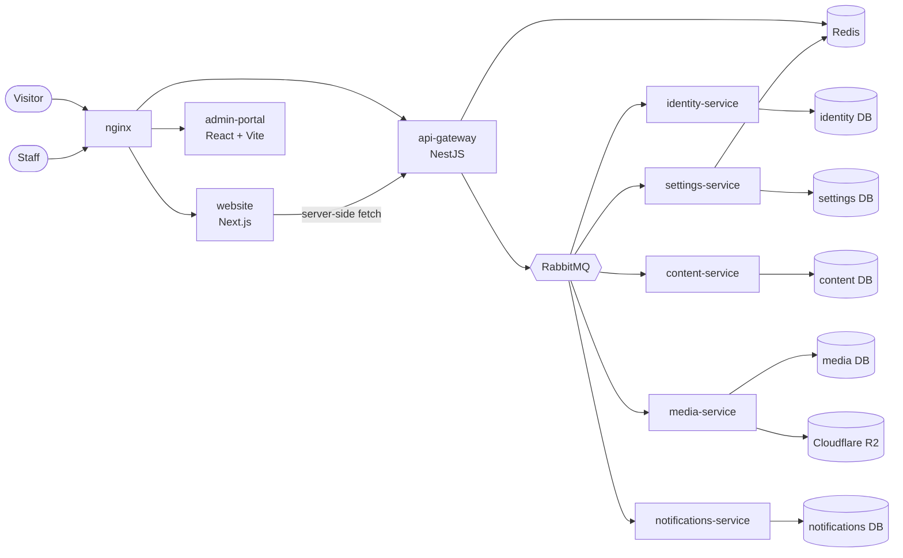

<p align="center">
  
</p>

<h1 align="center">Sanad Tech · سند التقنية</h1>

<p align="center">
  The platform for a software house: an Arabic-first marketing website, an admin portal that
  controls every word and image on it, and a NestJS microservices backend — in one Nx monorepo.
</p>

<p align="center">
  
  
  
  
  
  
</p>

---

## What it is

Sanad Tech is a software company that delivers client projects phase by phase. This repository is
the company's own platform, built to the same standard it sells:

- **Public website** (Next.js) — Arabic by default (right-to-left), English second. Every text,
  image, number and brand colour comes from the backend, with built-in defaults so no page ever
  renders blank. Animated landing page with a three.js scene, with a reduced-motion fallback.
- **Admin portal** (React + Vite) — staff manage the whole website from here: pages, services,
  portfolio, blog, FAQ, menus, team, testimonials, media library, branding and settings, plus a
  leads inbox, notifications and a stats dashboard.
- **Backend** — an API gateway and five NestJS services talking over RabbitMQ, each with its own
  PostgreSQL database.

**Status:** the website and admin portal are built and tested; the cookie-consent UI is in progress.
Deployment, the client portal, CRM and the rest of the ERP are planned in
[`docs/plans`](docs/plans). Development has been paused since August 2026.

## Architecture



| App                                                   | Role                                                                                                                                                                       |
| ----------------------------------------------------- | -------------------------------------------------------------------------------------------------------------------------------------------------------------------------- |
| [`api-gateway`](apps/api-gateway)                     | The only public API. Verifies the JWT once and forwards the caller's identity to services in message headers. Rate limiting, Helmet, deny-by-default CORS, body-size caps. |
| [`identity-service`](apps/identity-service)           | Users, roles, permissions (RBAC); RS256 access + refresh tokens.                                                                                                           |
| [`settings-service`](apps/settings-service)           | Branding and every configurable value, resolved override → global → coded default and cached in Redis. Encrypted vault (AES-256-GCM) for integration secrets.              |
| [`content-service`](apps/content-service)             | The CMS: pages, sections, services, portfolio, blog, FAQ, menus — with Arabic/English translation tables. Contact and project-request forms create leads.                  |
| [`media-service`](apps/media-service)                 | Media library. Files upload straight from the browser to Cloudflare R2 with presigned URLs, so file bytes never pass through the API.                                      |
| [`notifications-service`](apps/notifications-service) | Email and in-app notifications, driven by events.                                                                                                                          |
| [`website`](apps/website)                             | Public site: home, about, services, portfolio, process, blog, FAQ, careers, contact, request-a-project.                                                                    |
| [`admin-portal`](apps/admin-portal)                   | The staff back office described above.                                                                                                                                     |

Shared code lives in [`libs/`](libs): [`contracts`](libs/contracts) (every Zod schema, message
pattern and event, defined once), [`shared/*`](libs/shared) (database base repositories, messaging,
auth, cache, i18n, audit, money, sequences, config/design tokens) and [`web/ui`](libs/web/ui).

## Engineering highlights

- **Database per service, no shared tables.** Each service owns its PostgreSQL database, Drizzle
  schema and migrations. Services never import each other; module boundaries are enforced by Nx tags.
- **Reliable messaging.** Reads use RabbitMQ request/reply. Writes publish events through a
  **transactional outbox**, and consumers are **idempotent** — a contact form submitted once sends
  its email and in-app notice exactly once, even when RabbitMQ redelivers the message.
- **An event catalog checked at compile time.** Every event lives in one catalog in
  `libs/contracts`; publishing a name that is not in the catalog does not compile, and an event
  with no consumer must state why.
- **Clean layering, enforced by lint.** Domain / application / infrastructure layers per service;
  only repositories may touch the database. Two custom ESLint rules in [`tools/lint`](tools/lint)
  enforce folder layout and block event publishing that bypasses the outbox.
- **Lead handling.** Per-country phone validation (E.164), duplicate detection inside a
  configurable time window, and a 0–100 spam score computed from the submission alone.
- **Privacy by default.** Tracking tags (GA4, GTM, Meta, Snap, TikTok) are configured from the
  admin portal, and Google Consent Mode v2 starts as _denied_ before any tag can load. Consent is
  versioned and asked again when the policy changes.
- **Arabic first, for real.** RTL is the default; styles use CSS logical properties only, and tests
  fail when the Arabic and English translation files drift apart.
- **Test-driven.** 347 test files (Vitest + Testing Library). Database tests run against
  dedicated `*_test` databases, never the dev data.
- **One-command dev stack.** Docker Compose runs every service, database, Redis, RabbitMQ and nginx
  with hot reload, so code changes apply without rebuilding images.

## Tech stack

| Area           | Tools                                                                                                                   |
| -------------- | ----------------------------------------------------------------------------------------------------------------------- |
| Monorepo       | Nx 23, pnpm 9, TypeScript 5.9 (strict)                                                                                  |
| Backend        | NestJS 11 microservices, RabbitMQ, PostgreSQL 16 + Drizzle ORM, Redis 7, Zod                                            |
| Website        | Next.js 15 (App Router), React 19, three.js + React Three Fiber, GSAP, Framer Motion, hand-written CSS on design tokens |
| Admin portal   | React 19 + Vite, Redux Toolkit / RTK Query, React Router 7, Tailwind CSS + Radix UI (shadcn), React Hook Form, i18next  |
| Storage        | Cloudflare R2 (S3 API)                                                                                                  |
| Testing        | Vitest, Testing Library                                                                                                 |
| Infrastructure | Docker Compose, nginx                                                                                                   |

## Run it locally

Requires Node 20.19+, pnpm 9 and Docker.

```bash
pnpm install
node infra/scripts/dev-env-init.mjs   # creates infra/.env.development with a fresh JWT keypair
infra/scripts/dev-up.sh full          # starts every container (or pick profiles, see the script)
infra/scripts/dev-health.sh           # checks that everything came up
```

| URL                                | What                                                              |
| ---------------------------------- | ----------------------------------------------------------------- |
| <http://localhost:8190>            | Website                                                           |
| <http://localhost:8190/admin>      | Admin portal (seed login: `admin@sanad.tech` / `change-me-admin`) |
| <http://localhost:8190/api/health> | Gateway health check                                              |

Run the checks with the stack stopped (`infra/scripts/dev-down.sh`):

```bash
pnpm nx run-many -t typecheck lint test build --parallel=2
```

A Postman collection for every endpoint is in [`docs/postman`](docs/postman).

## How it is built

Work follows written phase plans, test first. Every phase has to pass two gates before it counts as
done: a code check (typecheck, lint, tests, build, plus checks against the project rules) and a
runtime check that boots the Docker stack and confirms every service is healthy.

- [`docs/plans`](docs/plans) — the system design, architecture and phase plans
- [`docs/rules.md`](docs/rules.md) — the engineering rules every change must follow
- [`docs/PROGRESS.md`](docs/PROGRESS.md) — the build log, phase by phase

The project is developed with Claude Code as an AI pair programmer. [`CLAUDE.md`](CLAUDE.md) and
[`.claude/`](.claude) hold the project instructions and the review agents that run the two gates.

## Author

**Kais Al Husrom** — full-stack software engineer ·
[Portfolio](https://kaisalhusrom.com/en) · [LinkedIn](https://www.linkedin.com/in/kais-al-husrom-943b48233/)

## License

Copyright © 2026 Kais Al Husrom. All rights reserved.

This repository is public so the work can be reviewed. No licence is granted to use, copy, modify or
distribute the code, in whole or in part, without written permission.
